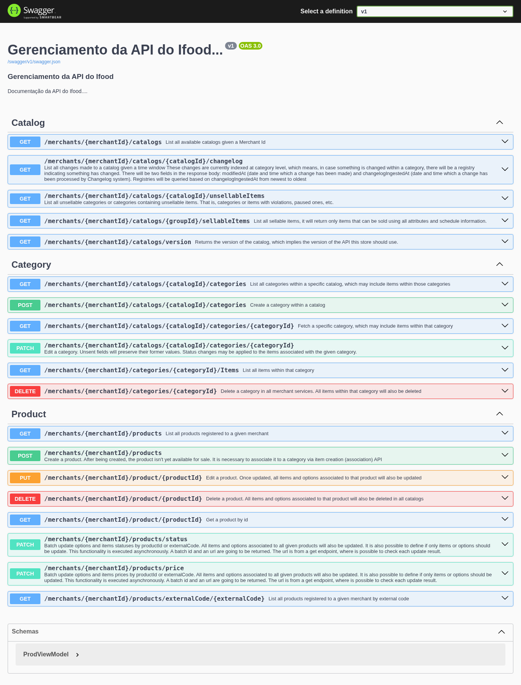
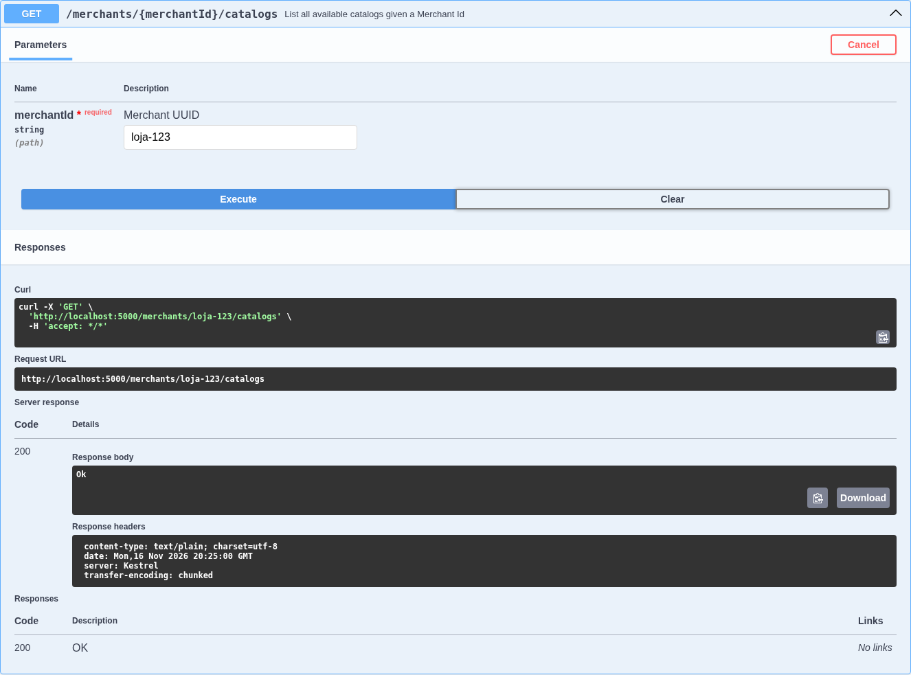

# 🍔 iFood Catalog API (mock)

API em **ASP.NET Core (.NET 8)** que reproduz a **estrutura de rotas da API de Catálogo do iFood** (catálogos, categorias e produtos de um *merchant*), com documentação **Swagger** gerada a partir dos comentários XML e logs com **Serilog**. É um *mock* para estudo: as rotas, parâmetros e modelos estão definidos e documentados, e todas as respostas retornam `"Ok"`, sem banco de dados.

Projeto acadêmico da disciplina de Linguagem de Programação (Unoeste).


## 📸 Screenshots

> Capturadas rodando a API localmente.

**Swagger com todos os endpoints**



**Testando um endpoint pelo "Try it out"**



## ✨ O que o projeto tem

- **19 endpoints** organizados em três controllers: `Catalog`, `Category` e `Product`.
- Rotas com parâmetros de caminho (`merchantId`, `catalogId`, `categoryId`, `productId`, `externalCode`) e de query.
- **ViewModels** com validação por *Data Annotations* (`[Required]`, `[Range]`; ex.: `limit` de 1 a 200 em `GET /products`) e comentários XML que aparecem no Swagger.
- **Swagger/OpenAPI** configurado com título, descrição e comentários dos controllers.
- **Serilog** gravando erros em arquivos `.json` (formato compacto) e `.log`, com rotação diária.

## 🔌 Endpoints

**Catalog**

| Método | Rota | Descrição |
|---|---|---|
| GET | `/merchants/{merchantId}/catalogs` | Lista os catálogos do merchant |
| GET | `/merchants/{merchantId}/catalogs/{catalogId}/changelog` | Alterações do catálogo em um período (`startDate`, `endDate`) |
| GET | `/merchants/{merchantId}/catalogs/{catalogId}/unsellableItems` | Categorias/itens que não podem ser vendidos |
| GET | `/merchants/{merchantId}/catalogs/{groupId}/sellableItems` | Itens disponíveis para venda |
| GET | `/merchants/{merchantId}/catalogs/version` | Versão do catálogo |

**Category**

| Método | Rota | Descrição |
|---|---|---|
| GET | `/merchants/{merchantId}/catalogs/{catalogId}/categories` | Lista categorias (`includeItems`) |
| POST | `/merchants/{merchantId}/catalogs/{catalogId}/categories` | Cria categoria |
| GET | `/merchants/{merchantId}/catalogs/{catalogId}/categories/{categoryId}` | Busca categoria |
| PATCH | `/merchants/{merchantId}/catalogs/{catalogId}/categories/{categoryId}` | Edita categoria |
| GET | `/merchants/{merchantId}/categories/{categoryId}/Items` | Itens da categoria |
| DELETE | `/merchants/{merchantId}/categories/{categoryId}` | Remove categoria |

**Product**

| Método | Rota | Descrição |
|---|---|---|
| GET | `/merchants/{merchantId}/products` | Lista produtos (`limit`, `page`) |
| POST | `/merchants/{merchantId}/products` | Cria produto |
| GET | `/merchants/{merchantId}/product/{productId}` | Busca produto |
| PUT | `/merchants/{merchantId}/product/{productId}` | Edita produto |
| DELETE | `/merchants/{merchantId}/product/{productId}` | Remove produto |
| PATCH | `/merchants/{merchantId}/products/status` | Atualiza status em lote |
| PATCH | `/merchants/{merchantId}/products/price` | Atualiza preços em lote |
| GET | `/merchants/{merchantId}/products/externalCode/{externalCode}` | Busca por código externo |

## 📁 Estrutura do projeto

```
ifoodapi/IntroAPI/IntroAPI/
├── IntroAPI.sln
├── IntroAPI/
│   ├── Controllers/        # CatalogController, CategoryController, Productcontroller
│   ├── ViewModel/          # DateViewModel, ItemsViewModel, ProdViewModel, ProductViewModel...
│   ├── Properties/launchSettings.json
│   ├── Program.cs          # Serilog + Swagger + Controllers
│   └── IntroAPI.csproj
└── ifood/                  # Projeto console auxiliar (Hello World)
```

## ▶️ Como executar

Pré-requisito: **.NET 8 SDK**.

```bash
git clone https://github.com/lukinha21/ifood-catalog-api-mock.git
cd ifood-catalog-api-mock/ifoodapi/IntroAPI/IntroAPI/IntroAPI
dotnet run
```

Abra a URL mostrada no terminal (ex.: `http://localhost:5000/index.html`) para acessar o Swagger. Também é possível abrir o `IntroAPI.sln` no Visual Studio e executar com F5.

## 👨‍💻 Autor

**Lucas Alexandre**, estudante de Sistemas de Informação na Unoeste

- GitHub: [@lukinha21](https://github.com/lukinha21)
- LinkedIn: [Lucas Silva](https://www.linkedin.com/in/lucas-silva-025583180)
